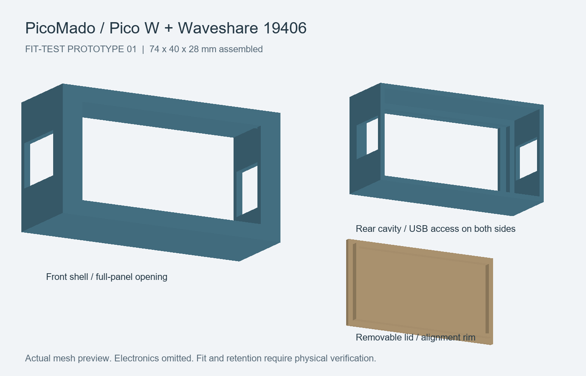

# PicoMado Case

Raspberry Pi Pico W + Waveshare Pico-ePaper-2.13 (SKU 19406 / V4) 用の3Dプリントケース集。操作ボタンなし。

**実機適合と実際の印刷は未検証の試作データです。** 最初に本体を印刷し、基板・パネル・ケーブルの収まりを確認してください。

## ケース一覧

寸法は幅 × 高さ × 奥行、単位はmmです。

| デザイン | 特徴 | 完成寸法 | 説明 |
| --- | --- | --- | --- |
| **Soft Frame v0.1（新規追加）** | 角丸のフォトフレーム風。独立した卓上台座付き | ケース82 × 48 × 28／台座込み82 × 52 × 46 | [組み立て説明](soft_frame/README_ja.md) |
| Little Retro TV v0.3 | 飾りダイヤルと台座を備えたレトロテレビ型 | 台座込み約110 × 64 × 70 | [組み立て説明](retro_tv/README_ja.md) |
| Basic v0.1 | シンプルな箱型。スタンドなし | 74 × 40 × 28 | [組み立て説明](basic/README_ja.md) |

## Soft Frame v0.1

丸い角と広めの額縁で、卓上に置けるフォトフレーム風に仕上げたケースです。画面は垂直に立ち、下辺が台座の溝に入ります。本体をアイボリー、ふたと台座をセージグリーンにする配色がおすすめです。

- **印刷する部品：** 本体・背面ふた・卓上スタンドを各1個
- **ケース外寸：** 82 × 48 × 28 mm（ふた装着時）
- **台座：** 74 × 46 mm、厚さ9 mm。ケースを置いた全体の高さは52 mm
- **編集：** `SoftFrame.scad`で寸法や公差を調整可能
- **固定：** ふたはテープ固定を想定。台座は置き型で、ケースをロックしません

[印刷・組み立て説明](soft_frame/README_ja.md) · [STL・編集データ](soft_frame/) · [一式ダウンロード（ZIP）](downloads/PicoMado_SoftFrame_v01.zip)

## Little Retro TV v0.3

台座と飾りダイヤルを備えたレトロテレビ型です。v0.3では基板周囲の余裕を片側1.0 mmへ、Pico W側の収納空間を72×38 mmへ広げ、ケースの奥行を4 mm増やしました。台座は110×70 mm、本体受け幅は72 mmに拡大しています。ダイヤルとスピーカー風の溝は装飾です。

本体・ふた・台座はv0.3のセットを使用してください。旧版は[前回のZIP](downloads/PicoMado_RetroTV_v02.zip)に残しています。

[印刷・組み立て説明](retro_tv/README_ja.md) · [STL・編集データ](retro_tv/) · [一式ダウンロード（ZIP）](downloads/PicoMado_RetroTV_v03.zip)

## Basic v0.1

横置き・垂直表示のシンプルな箱型ケースです。本体と背面ふたの2部品で、スタンドは付属しません。

[印刷・組み立て説明](basic/README_ja.md) · [STL・編集データ](basic/) · [一式ダウンロード（ZIP）](downloads/PicoMado_case_v01.zip)

## 印刷を始めるには

1. 好きなケースのZIPをダウンロードして展開します。
2. 各フォルダーの説明書を読み、STLをスライサーにmm単位・100%で読み込みます。
3. 本体は前面、ふたは外面、台座は底面をベッドに置きます。PLA、0.4 mmノズル、積層0.2 mm、壁3周程度を試作の出発点にしてください。
4. ケーブル開口のブリッジと必要なサポートを確認し、まず本体だけを印刷します。
5. 非通電でパネル位置・基板周辺・積層高さ・USBプラグの収まりを確認してから、残りの部品を印刷します。

基板はガラスや電子部品を避けた露出基板端で、取り外せる絶縁固定材を使って留める想定です。ふたで基板を無理に押さえないでください。

## データと検証状況

- STLは印刷用の形状データ、SCADはOpenSCADで寸法を変更するための編集データです。
- 各ケースの`mesh_check.json`に、メッシュ辺の閉鎖と正の体積の検査結果を保存しています。
- Soft Frameの3部品はOpenSCADで出力しています。
- 形状データの検査は、印刷成功や実機適合を保証するものではありません。各説明書に設計上の仮定・印刷方向・公差を記載しています。
- Pico 2 W用としては未検証です。

## 参照

- [PicoMado](https://github.com/tanep3/PicoMado)
- [Waveshare 19406](https://www.waveshare.com/Pico-ePaper-2.13.htm)

ケース形状は独自作成です。PicoMado / Waveshare公式のケースではありません。
