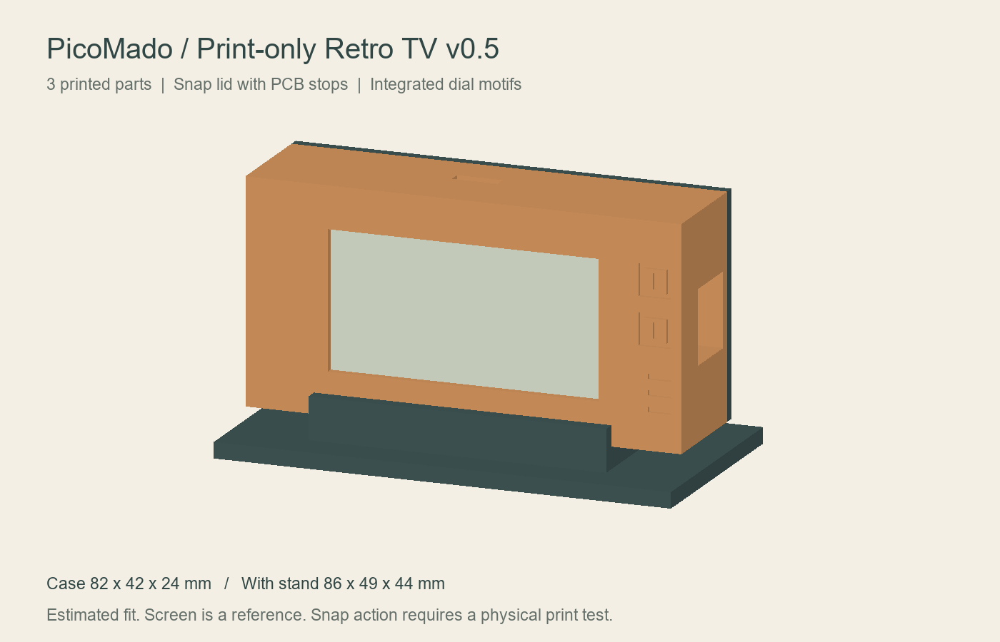

# PicoMado Case

Raspberry Pi Pico W + Waveshare Pico-ePaper-2.13 (SKU 19406 / V4) 用の3Dプリントケース。操作ボタンなし。

## 最新版：Little Retro TV v0.2

台座と飾りダイヤルを備えたレトロテレビ型です。台座込み約90 × 63 × 52 mm（幅 × 高さ × 奥行）。

- [印刷・組み立て説明](retro_tv/README_ja.md)
- [STL・編集データ](retro_tv/)
- [一式ダウンロード（ZIP）](downloads/PicoMado_RetroTV_v02.zip)

## 初版 v0.1

- [シンプルな箱型ケース](basic/README_ja.md)
- [初版ZIP](downloads/PicoMado_case_v01.zip)

## 状態

**実機適合と印刷は未検証の試作データです。** STLのメッシュ辺の閉鎖と正の体積は検査済み。パネル位置・積層高さ・USBプラグの収まりは仮組みで確認してください。ふたはテープ固定、基板は絶縁固定材で留める想定です。ダイヤルとスピーカー風の溝は装飾です。

編集用データはOpenSCAD形式です。各フォルダーの説明書に印刷方向・公差・注意点を記載しています。

## 参照

- [PicoMado](https://github.com/tanep3/PicoMado)
- [Waveshare 19406](https://www.waveshare.com/Pico-ePaper-2.13.htm)

ケース形状は独自作成です。PicoMado / Waveshare公式のケースではありません。
