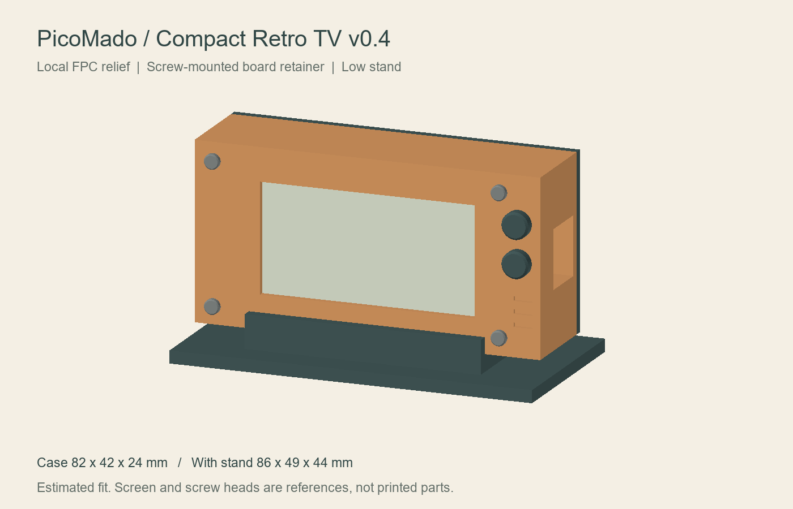
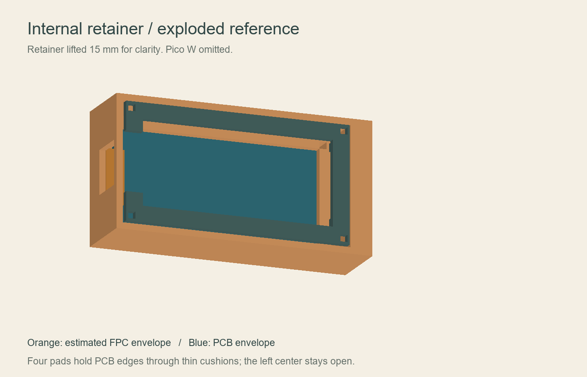

# Compact Retro TV v0.4 — FPCの逃げと基板押さえ付き

Raspberry Pi Pico W＋Waveshare Pico-ePaper-2.13 / WAVESHARE-19406（白黒、V4想定）用。前版の全体的な拡大を見直し、左側のFPCに必要な場所だけ余裕を設けた試作ケースです。

## 大きさと変更点

- 本体＋ふた：**82×42×24 mm**。飾りダイヤルの前方突起3 mm、ねじ頭は別。
- 台座込み：**86×49×44 mm**（幅×高さ×奥行）。背の低い台座です。
- v0.3の台座込み110×64×70 mmから縮小。
- 基板収納部：65.7×31.2 mm。公称基板65×30.5 mmに対して片側0.35 mmの余裕。
- 左側FPCの逃げ：基板左端から外側へ4 mm、上下19 mm。前面から1.4 mm以降に空間を設けています。
- 画面窓：51×26 mm。基板中心から右へ2.5 mmずらしています。
- 基板押さえ枠を追加。ガラスとFPCを避け、4か所の基板端を薄いクッション越しに保持する設計。

## 推定に用いた情報

| 項目 | 値と根拠 |
|---|---|
| 基板外形 | 65×30.5 mm：メーカー公表 |
| パネル外形 | 59.2×29.2×1.05 mm：メーカーWiki |
| 表示領域 | 48.55×23.70 mm：メーカー公表 |
| FPCの張り出し | 約2〜3 mm、上下約15〜17 mm：ユーザー提供の商品写真の比率から推定 |
| 表示領域の中心 | 基板中心から右へ約2.5 mm：同写真から推定 |
| 電子ペーパーPCB厚 | 1.6 mm：設計上の仮定。型番資料で未確認 |
| Pico W接続時の総厚み | 14〜18 mm程度を想定。ヘッダー種類により変わる |

**実測した専用フィットモデルではありません。** SKUが同じでもパネル配置・ヘッダー・基板実装の違いがあり得ます。推定したPCB、ガラス、FPC、Pico Wの外形モデルに対する非干渉を計算で確認していますが、実物の各部品やフレキの曲がりまでは検証できていません。

## 印刷部品と追加部材

| ファイル／部材 | 数量 | 用途 |
|---|---:|---|
| tv_body.stl | 1 | 本体・前面枠 |
| tv_lid.stl | 1 | 背面ふた |
| tv_retainer.stl | 1 | 内部の基板押さえ枠 |
| tv_stand.stl | 1 | 低い卓上台座 |
| tv_knob_print_twice.stl | 2 | 飾りダイヤル |
| M2×10 mm なべ小ねじ | 4 | 前面から押さえ枠を固定 |
| M2六角ナット | 4 | 押さえ枠の背面で固定。対辺約4 mm、厚み約1.6 mmを想定 |
| 厚さ約0.5 mmの柔らかい絶縁クッション | 4片 | 約2×2.5 mmに切り、枠の接触パッドに貼る |
| 取り外せるテープ | 少量 | 背面ふたの固定 |

ねじ・ナット・クッションはSTLに含まれません。自己タッピングねじではなく、ナット付きのM2小ねじを使用します。穴は印刷形状として一辺2.2 mmの角穴です。印刷で縮んだ場合は、電子部品を入れる前に適切に穴をさらってください。ねじを基板の穴に通す構造ではありません。

**全パーツがv0.4専用です。旧版の本体・ふた・台座・ダイヤルとは混ぜないでください。**

## 固定構造

図は背面からの説明用で、押さえ枠を本来の位置から15 mm浮かせています。青は基板、オレンジはFPCの推定外形です。Pico Wは省略しています。

基板の前面は本体前面から3 mm位置の段に載ります。パネル用のくぼみがあり、ガラスが前面枠に押し付けられないようにしています。押さえ枠は前面から6〜8 mmの位置で本体の段に着座します。

枠の4つの接触パッドは、基板端のx=±31.4 mm、y=±11.75 mm付近です。PCB厚1.6 mmの場合、パッドと基板背面に0.3 mmのすきまができるので、約0.5 mmの柔らかい絶縁クッションでガタつきを吸収します。接触予定位置に実物の部品・はんだ・FPCがある場合は、そのまま締め付けず、パッド位置を修正してください。ガラスや配線をクッションで押さえる用途ではありません。

4本のねじはx=±34 mm、y=±16.7 mm。前面から本体と枠を貫通し、背面側のナットで固定します。枠が段に軽く着座するところで止め、基板を曲げるほど締め付けないでください。クッションを入れずにねじを強く締めても0.3 mmのすきまはなくなりません。

左中央のFPC部には枠の切り欠きがあり、ここにパッドはありません。位置決めされた基板の表示領域が窓内に収まることを、写真から推定した表示中心と片側0.35 mmの基板移動量で計算しています。実物の表示位置が異なる場合はSCADの窓の位置を変更します。

## 印刷と組み立て

1. STLをmm単位・100%で取り込みます。PLA、0.4 mmノズル、積層0.2 mm、壁3周程度を試作の出発点にします。
2. 全STLは印刷用に配置済み。本体は前面、ふたは外面、押さえ枠は平らな面、台座は底面、ダイヤルは底面がz=0です。押さえ枠の小さなパッドは上向きに出力されます。
3. 本体の側面USB開口は14 mmのブリッジです。スライサーで必要なサポートを確認します。台座は底板の上に受けが載るため、前版のような受け下面の張り出しはありません。
4. 本体と押さえ枠を先に印刷し、バリ・ねじ穴を整えます。ダイヤルを右側前面（x=38.5、y=1と10 mm）に接着し、硬化させます。
5. 枠の4パッドにクッションを貼ります。電子ペーパーを背面から入れ、FPCを左中央の逃げに収めます。ガラスとFPCを引っ張ったり、段の下に挟んだりしないでください。
6. Pico Wやヘッダーが中央開口を通るように押さえ枠を入れます。4本のM2×10 mmねじを前面から通し、背面側でナットを取り付けます。ナットが壁に近い場合は平面側を壁に沿わせて、無理なく収まる向きにします。
7. 基板が曲がらずガタつかない程度に軽く固定し、表示領域とUSB接続を確認します。USB開口は左右にありますが、実際のポート位置・プラグの形状で挿入可否が変わります。
8. 背面ふたを差し込み、テープで留めます。ふたリムは片側0.3 mmのすきまがある位置決め用で、スナップ爪はありません。
9. 本体を台座の中央に載せます。溝は24.6 mmで片側0.3 mmの余裕、差し込み深さ4 mmです。必要に応じて薄い滑り止めを使います。台座は本体をロックする構造ではありません。

## 検証

全5種類のSTLで全辺の2面共有と正の体積を確認しました。本体と押さえ枠、本体とふた、台座と本体／ふた、および推定した部品外形との干渉を計算で確認しています。ガラスやFPCの実物への適合、ねじの取り付け、保持力、転倒安定性、印刷は未検証です。OpenSCADソースはSTL生成と同じ直方体の組み合わせから出力していますが、OpenSCAD本体でのコンパイルは未実施です。

## 参照

- https://www.waveshare.com/Pico-ePaper-2.13.htm
- https://www.waveshare.com/wiki/Pico-ePaper-2.13
- https://github.com/tanep3/PicoMado

ケースは独自作成で、Waveshare / PicoMado公式のケースではありません。
